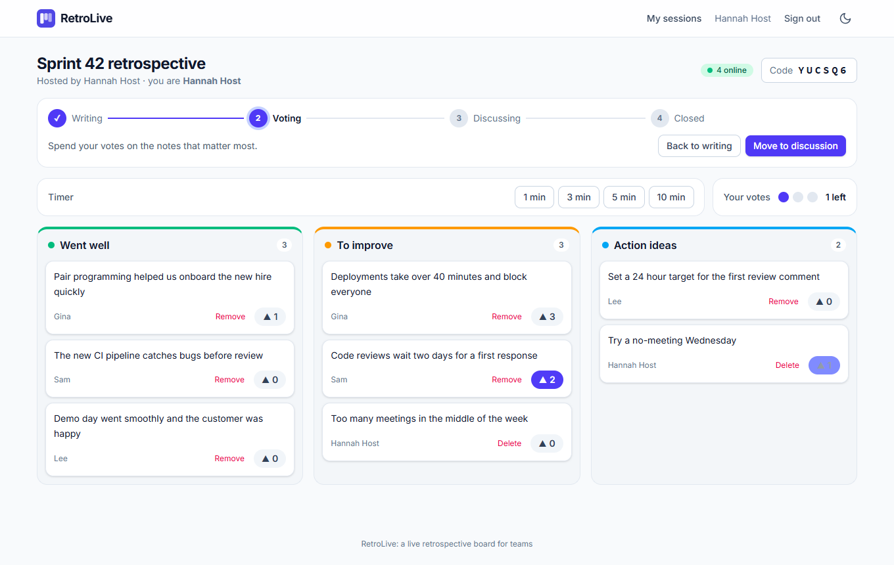
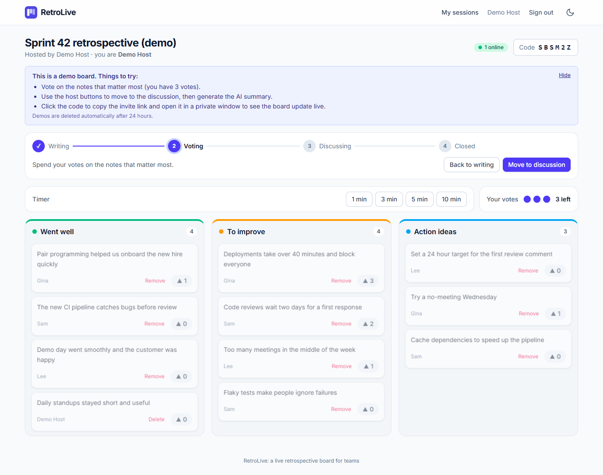
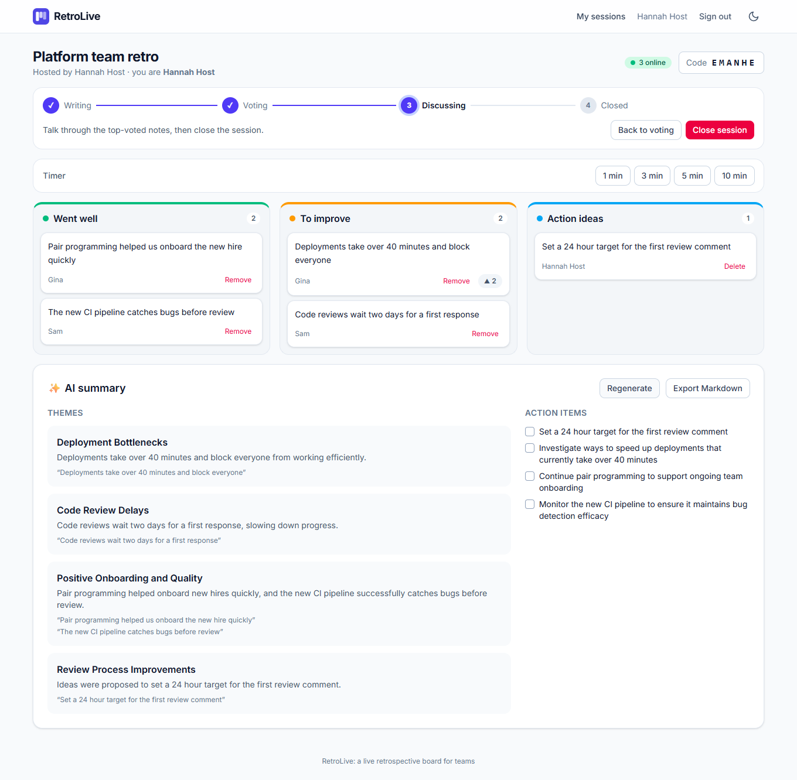
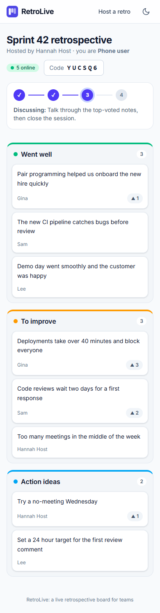
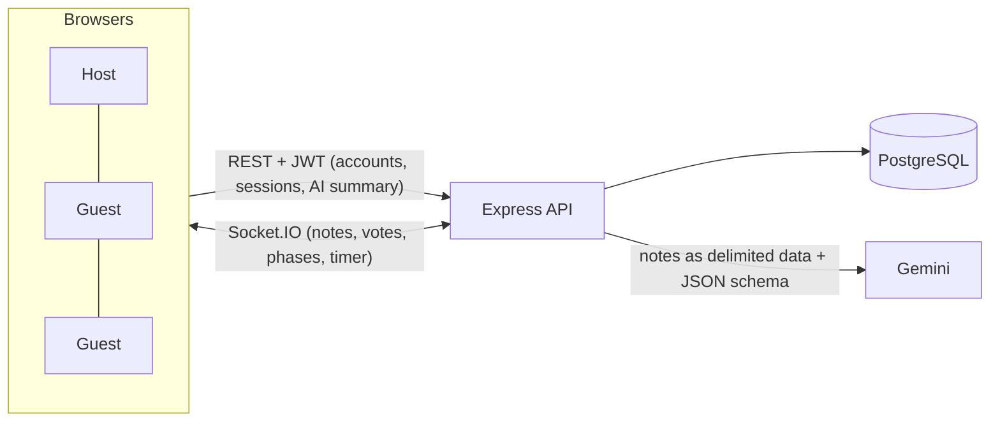

# RetroLive

A live team retrospective board. A host opens a session and shares a short code. Everyone joins from their own device
(no account needed), adds notes, and votes. Notes, votes, the timer and the session phase update **in real time** for
everyone, and one click turns the notes into themes and action items with AI.

> **Live demo:** <https://retrolive.vercel.app> &nbsp;|&nbsp; **API health:** <https://retrolive-api.onrender.com/health>
>
> **No sign-up needed:** click **Try a demo retro** on the home page for a ready-made board. Then click the code to copy the
> invite link and open it in a second window to watch the board stay in sync. (Free hosting: the very first request after a quiet period can take up to a minute
> while the server wakes up.)



| One click opens a ready-made demo board | AI turns notes into themes and action items |
|---|---|
|  |  |

| Join from any device, no sign-up |
|---|
|  |

## How a retro runs

1. **Host** signs in, creates a session and shares the 6-character code (or the invite link).
2. **Writing:** everyone adds notes to *Went well*, *To improve* and *Action ideas*. Each note shows its author's nickname.
3. **Voting:** each person has **3 votes**. Totals update live; who voted for what stays private.
4. **Discussing:** the most voted notes rise to the top. The host can generate the **AI summary** and **export Markdown**.
5. **Closed:** the board becomes read-only. The host moves between phases and can run a countdown timer at any step.

## Features

- Real-time sync with Socket.IO: notes, votes, phase changes, timer and who is online
- Host accounts (JWT); guests join with a code and a nickname, no account
- Phase rules enforced by the server (no notes while voting, no votes while writing, host-only controls)
- Exactly 3 votes per person, even if someone clicks very fast on several notes at once
- Server-driven countdown timer that stays correct on every screen, whatever the device clock says
- AI summary with Google Gemini: themes with the notes behind them, plus 3 to 5 action items
- **"Try a demo retro" button**: a private, ready-made sample board for every visitor, deleted automatically after 24 hours
- Markdown export of the finished retro, light and dark theme, works on a phone
- Reconnects automatically and restores your identity and your votes after a refresh or a network drop

## Tech stack

| Layer | Technology |
|---|---|
| Web app | React 19, TypeScript, Vite, Tailwind CSS 4, React Router 7, Socket.IO client |
| API | Node.js, Express 5, TypeScript, Socket.IO, Zod validation, Helmet |
| Database | PostgreSQL 16, Prisma ORM with SQL migrations |
| AI | Google Gemini API behind a small `LlmClient` interface, structured JSON output |
| Testing | Vitest, Testing Library, Supertest, real WebSocket clients, Playwright with several browsers at once |
| DevOps | npm workspaces monorepo, Docker, Docker Compose, nginx, GitHub Actions, Render + Vercel + Neon |

## Architecture



The repo is a monorepo with three packages. The one that makes TypeScript worth it is **`shared`**: a single file that
defines the phases, limits, data shapes and every socket message. Both the API and the web app import it, so a message
can never be shaped differently on each end, and a mismatch is a compile error instead of a runtime surprise.

```
shared/     types and constants used by both sides (phases, limits, socket events)
backend/    Express API, Socket.IO server, Prisma schema and migrations, tests
frontend/   React app, tests
e2e/        Playwright tests that drive real browsers
```

### Data model (5 tables)

`User` (host accounts, plus a flag for the throwaway demo accounts), `RetroSession` (title, join code, phase, timer end, saved AI summary), `Participant` (the host
or a guest in one session), `Note`, and `Vote` (unique per participant and note).

### Design decisions worth a look

- **The server is the source of truth.** Clients send intentions ("vote for this note"); the server checks the rules and
  broadcasts the result. The browser never decides whether a vote counts.
- **The 3-vote limit survives races.** Voting runs in a transaction that first locks the participant's row
  (`SELECT … FOR UPDATE`), so several simultaneous votes are checked one after another. A test fires 8 at once and
  asserts that exactly 3 are accepted.
- **Identity comes from the database, not the client.** The socket handshake carries a signed participant token, but who
  you are and whether you are the host is loaded from the database. Host and participant tokens carry different `typ`
  claims, so one can never be used as the other.
- **Ownership is enforced in queries.** Another host's session answers `404`, exactly like a missing one, so ids cannot
  be probed.
- **Private by design.** Vote *totals* are broadcast to the room; *who voted for what* is only ever sent to the voter's own
  connections.
- **A reducer applies every server message.** Messages are idempotent (the author receives their own note twice, as the
  acknowledgement and the broadcast), and a reconnect replaces everything with a fresh snapshot.
- **The timer uses the server's clock.** The client measures the offset between its clock and the server's and counts down
  against that, so everyone sees the same time.
- **AI is treated as untrusted.** Notes go to the model as delimited data with an instruction to ignore instructions inside
  them; the answer is schema-constrained, then validated, trimmed and de-duplicated, and every note id it returns is checked
  against the real notes. There is a fallback model, a per-session rate limit, and a graceful failure path.
- **Rate limits fit the traffic.** Sign-in is strict (20 a minute per IP); joining is generous (240), because a whole team
  behind one office network arrives from the same address at the same moment.
- **The demo button cannot flood the database.** Each click creates a small private copy (about 25 rows) under a flagged account.
  Demos are limited to 5 an hour per visitor and 200 at once, cannot be signed into with a password, and an hourly job deletes
  every demo older than 24 hours (sessions, notes and votes follow through cascading deletes). Cleanup only ever touches
  flagged accounts, and a test proves real accounts are never deleted, however old.
- **One frontend build for every environment.** The API address is read at runtime from `config.json`, written from the
  `API_URL` variable at build time, so the same code runs on localhost, in Docker and on Vercel.

## Run it locally

### Option A: Docker (everything in containers)

```bash
cp .env.example .env        # then set JWT_SECRET (and GEMINI_API_KEY if you want the AI summary)
docker compose up --build
```

Open <http://localhost:8080>. The API container gets the same 512 MB memory limit as a free Render instance.

### Option B: development mode

Requirements: Node 22+ and a local PostgreSQL with two empty databases, `retrolive` and `retrolive_test`.

```bash
cp .env.example .env        # set the database passwords, JWT_SECRET and optionally GEMINI_API_KEY
npm install
npm run db:deploy -w backend    # creates the tables
npm run dev:backend             # http://localhost:4000
npm run dev:frontend            # http://localhost:5173
```

On Windows, `.\run-local.ps1` does all of that and `.\run-local.ps1 -Stop` stops it.

### Configuration

| Variable | Purpose | Default |
|---|---|---|
| `DATABASE_URL` | PostgreSQL connection string | none (required) |
| `JWT_SECRET` | Signing key, at least 32 characters (the API refuses to start without it) | none (required) |
| `CORS_ORIGIN` | Comma-separated browser origins allowed to call the API | `http://localhost:5173` |
| `PORT` | Port of the API | `4000` |
| `GEMINI_API_KEY` | Enables the AI summary. Without it the button answers "unavailable" and everything else works | empty |
| `GEMINI_MODEL`, `GEMINI_FALLBACK_MODEL` | Primary and fallback model | `gemini-3.5-flash-lite`, `gemini-3.1-flash-lite` |
| `RATE_LIMITS_ENABLED` | Set to `false` only for the end-to-end tests | `true` (off under `NODE_ENV=test`) |
| `API_URL` _(web build)_ | API address baked into `config.json`; empty means same origin | unset (keeps `localhost:4000`) |

## Tests

```bash
npm test -w backend        # unit + REST + real-time tests against a real PostgreSQL (the *_test database)
npm test -w frontend       # reducer, components and screens
cd e2e && npm install && npx playwright test   # real browsers, several windows at once
```

- **Backend (97 tests):** unit tests for the rules, REST integration tests, and real-time tests where several actual Socket.IO clients
  talk to a real server and database: broadcasts, phase rules, the vote limit under concurrency, privacy of votes,
  reconnection, token rejection, flood and rate limits, and the demo (isolation, limits, and cleanup that never touches real accounts). The test setup refuses to run against any database whose name does
  not end in `_test`.
- **Frontend (49 tests):** the state reducer, countdown helpers, and the key components and screens (who sees which buttons in which phase).
- **End to end (39 tests):** a host and guests in separate browser windows, including voting, timers, reconnecting, closing a
  session, a phone layout, a deleted session ending for everyone in it, and the one-click demo.
  Start the stack with `.\run-local.ps1 -E2E` (rate limits off, because the tests create dozens of accounts a minute).
  `LIVE_AI=1` adds a test that calls the real Gemini API. It uses your installed Chrome; set `BROWSER=chromium` for Playwright's own.

## API overview

| Method and path | Description |
|---|---|
| `POST /api/auth/register`, `POST /api/auth/login`, `GET /api/auth/me` | Host accounts and JWT |
| `GET/POST /api/sessions`, `GET/DELETE /api/sessions/:id` | A host's sessions |
| `POST /api/sessions/:id/enter` | The host takes their place in their own session (returns the socket token) |
| `POST /api/sessions/:id/summary`, `GET /api/sessions/:id/export` | AI summary, Markdown export |
| `GET /api/join/:code`, `POST /api/join` | Look up a code, and join as a guest |
| `POST /api/demo` | Create a private demo board (limited per visitor, deleted after 24 hours) |
| `GET /health`, `GET /health/ready` | Cheap liveness check, and one that also checks the database |

The live protocol (client to server and back) is documented in code, in `shared/src/index.ts`.

## Deploy (free tiers)

1. **Database, Neon.** Create a project and a database (for example `retrolive`). Use the **direct** (non-pooled) connection
   string, ending in `?sslmode=require`. The API applies the migrations itself on startup.
2. **API, Render.** New Blueprint from this repository (`render.yaml`), then set `DATABASE_URL`, `CORS_ORIGIN` (your Vercel
   URL) and `GEMINI_API_KEY`. `JWT_SECRET` is generated for you. Render supports WebSockets on the free plan.
3. **Web app, Vercel.** Import the repository (the root directory stays the repo root, `vercel.json` does the rest) and set
   the environment variable `API_URL=https://<your-render-service>.onrender.com`.
4. Put the live links at the top of this README. (Done for the instance linked above.)

Free hosting notes: the API sleeps after a quiet period, so the first request can take up to a minute, and a sleeping server
drops its connections. The web app reconnects by itself and restores the full state. This version runs as a **single API
instance**: who is online and the rate limits are kept in memory. Running several instances would need a shared store
(for example the Socket.IO Redis adapter), which is deliberately out of scope here.

## Out of scope

Drag-to-reorder notes, comments, attachments, multiple boards or teams, an admin panel, password reset, social login and
offline editing.
